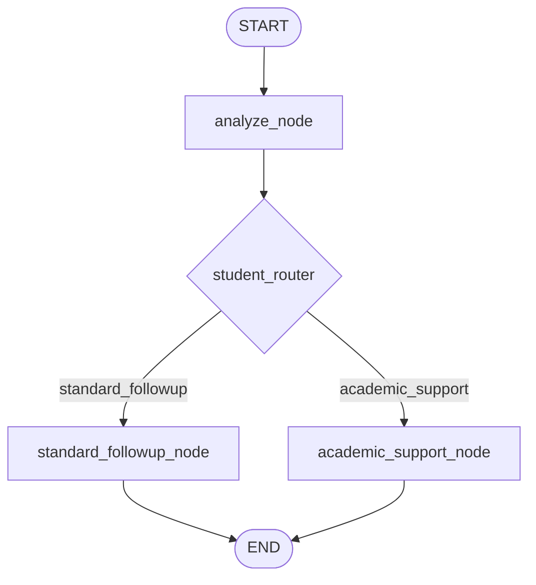
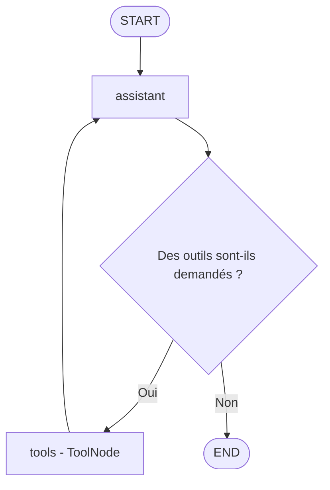

<p align="center">
  
  
  
  
  
  
  
</p>

---

# TP LangGraph — Gestion et accompagnement des étudiants

Ce TP met en pratique **LangGraph** à travers deux applications autour du suivi pédagogique des étudiants :

1. un **workflow conditionnel** qui analyse un dossier étudiant et choisit un parcours de suivi ;
2. un **agent conversationnel** qui utilise des outils Python pour calculer des indicateurs académiques.

La deuxième partie utilise **Groq API** comme fournisseur du modèle de langage.

> **Note :** les étudiants, notes, absences et présences présentés dans ce TP sont fictifs. Les seuils sont définis pour l'exercice et ne représentent pas nécessairement le règlement d'un établissement.

---

## Objectifs du TP

À la fin du TP, on met en œuvre les notions suivantes :

- définir un état partagé avec `TypedDict` ;
- créer des nœuds qui traitent et mettent à jour cet état ;
- relier les nœuds avec des arêtes simples et conditionnelles ;
- construire et compiler un graphe avec `StateGraph` ;
- créer des outils Python avec le décorateur `@tool` ;
- laisser un LLM choisir les outils à appeler ;
- exécuter les outils avec `ToolNode` ;
- gérer une boucle entre l'assistant et les outils jusqu'à l'obtention d'une réponse finale.

## Technologies et bibliothèques

| Technologie | Rôle dans le TP |
|---|---|
| Python | Langage de programmation |
| `uv` | Gestion du projet, de l'environnement virtuel et des dépendances |
| LangGraph | Construction et exécution des workflows et graphes d'agents |
| LangChain | Messages, outils et intégration du modèle |
| `langchain-groq` | Connexion au modèle via l'API Groq |
| Groq API | Fournisseur d'inférence du modèle de langage |
| `python-dotenv` | Chargement de la clé API depuis le fichier `.env` |
| Jupyter / IPykernel | Exécution du TP sous forme de notebook |

### Modèle de langage utilisé

La cellule d'initialisation exécutée dans le notebook utilise :

```python
llm = ChatGroq(
    model="openai/gpt-oss-20b",
    temperature=0
)
```

Le modèle est appelé via **Groq API**. `openai/gpt-oss-20b` est ici l'identifiant du modèle côté Groq ; cela ne signifie pas que le notebook utilise OpenAI API.

---

## Préparation de l'environnement

### 1. Installer `uv` (Windows / PowerShell)

Si `uv` n'est pas encore installé :

```powershell
powershell -ExecutionPolicy ByPass -c "irm https://astral.sh/uv/install.ps1 | iex"
uv --version
```

### 2. Créer le projet et l'environnement virtuel

À exécuter dans le dossier où le projet doit être créé :

```powershell
uv init --python 3.12 tp-langgraph-etudiant
cd tp-langgraph-etudiant
uv venv --python 3.12
```

Si le dépôt possède déjà son fichier `pyproject.toml`, il ne faut pas refaire `uv init` : ouvrir simplement le dossier du dépôt dans le terminal et créer l'environnement si nécessaire avec `uv venv`.

### 3. Installer les dépendances

```powershell
uv add langgraph langchain langchain-groq python-dotenv jupyter ipykernel
```

Enregistrer le kernel Jupyter :

```powershell
uv run python -m ipykernel install --user --name langgraph-etudiant --display-name "Python (LangGraph Etudiant)"
```

Lancer JupyterLab :

```powershell
uv run jupyter lab
```

Dans VS Code, ouvrir `TP_LangGraph_Etudiant.ipynb` et sélectionner le kernel **Python (LangGraph Etudiant)** ou l'interpréteur situé dans `.venv`.

### 4. Configurer Groq API

Créer un fichier `.env` à la racine du projet, au même niveau que le notebook et `pyproject.toml` :

```env
GROQ_API_KEY=votre_cle_api_groq
```

La clé API peut être créée depuis le tableau de bord Groq : <https://console.groq.com/keys>.

Ne jamais publier la vraie clé API sur GitHub. Ajouter les lignes suivantes au fichier `.gitignore` :

```gitignore
.env
.venv/
__pycache__/
.ipynb_checkpoints/
```

La première partie du TP ne nécessite pas de clé API. La deuxième partie nécessite une clé Groq valide et une connexion Internet.

---

# Partie 1 — Workflow conditionnel pour le suivi des étudiants

## 1. Description

Cette première partie consiste à créer un workflow qui reçoit les informations d'un étudiant, analyse son dossier puis choisit automatiquement l'un des deux parcours :

- **Suivi pédagogique standard** ;
- **Accompagnement pédagogique renforcé**.

Le workflow utilise un état `StudentState` contenant :

| Champ | Description |
|---|---|
| `name` | Nom de l'étudiant |
| `average` | Moyenne de l'étudiant sur 20 |
| `absences` | Nombre d'absences |
| `decision` | Décision prise par le nœud d'analyse |
| `result` | Message décrivant le traitement choisi |

## 2. Règle de décision

Le nœud `analyze_student` applique la règle pédagogique suivante :

- si la moyenne est supérieure ou égale à **10/20** et que le nombre d'absences est inférieur ou égal à **5**, le dossier est orienté vers le suivi standard ;
- dans les autres cas, le dossier est orienté vers l'accompagnement renforcé.

La fonction `student_router` récupère la décision et permet à LangGraph de choisir le nœud suivant.

## 3. Architecture du workflow



Le graphe est construit avec `StateGraph(StudentState)`, puis compilé avec `workflow.compile()`.

## 4. Tests et résultats

Deux dossiers fictifs ont été utilisés pour vérifier les deux branches du workflow.

### Cas 1 — Lina : suivi pédagogique standard

**Données d'entrée :**

| Information | Valeur |
|---|---:|
| Nom | Lina |
| Moyenne | 14,5/20 |
| Nombre d'absences | 2 |

**Résultat obtenu :**

```text
Le dossier de Lina a été analysé.
Le dossier de Lina est orienté vers un suivi pédagogique standard.
```

**Interprétation :** Lina a une moyenne supérieure à 10/20 et seulement 2 absences. Les deux conditions du suivi standard sont satisfaites. Le workflow sélectionne donc `standard_followup_node`.

### Cas 2 — Yassine : accompagnement pédagogique renforcé

**Données d'entrée :**

| Information | Valeur |
|---|---:|
| Nom | Yassine |
| Moyenne | 8,5/20 |
| Nombre d'absences | 7 |

**Résultat obtenu :**

```text
Le dossier de Yassine a été analysé.
Le dossier de Yassine est orienté vers un accompagnement pédagogique renforcé.
```

**Interprétation :** Yassine a une moyenne inférieure à 10/20 et 7 absences. Il ne satisfait pas les conditions du suivi standard. Le workflow choisit donc `academic_support_node`.

### Bilan de la partie 1

| Étudiant | Moyenne | Absences | Parcours sélectionné |
|---|---:|---:|---|
| Lina | 14,5/20 | 2 | Suivi standard |
| Yassine | 8,5/20 | 7 | Accompagnement renforcé |

Les deux tests confirment que le routage conditionnel dirige chaque dossier vers le nœud correspondant à la règle définie.

---

# Partie 2 — Agent étudiant avec Groq et des outils Python

## 1. Description

Dans cette partie, on construit un agent conversationnel qui reçoit une demande en langage naturel. Le modèle peut décider d'appeler des fonctions Python pour obtenir des résultats précis.

L'agent dispose de trois outils :

| Outil | Fonction |
|---|---|
| `calculate_average` | Calcule la moyenne d'une liste de notes sur 20 |
| `calculate_attendance_rate` | Calcule le pourcentage de présence |
| `check_validation` | Vérifie si la moyenne atteint le seuil de validation |

Des vérifications sont intégrées aux fonctions pour refuser les entrées incohérentes : liste de notes vide, notes hors de l'intervalle 0–20, nombre de séances invalide ou seuil hors de l'intervalle 0–20.

## 2. État et composants de l'agent

L'état `AgentState` conserve l'historique des messages :

```python
class AgentState(TypedDict):
    messages: Annotated[list[AnyMessage], add_messages]
```

Les principaux composants sont :

- `ChatGroq` : initialise le modèle de langage via Groq ;
- `bind_tools(tools)` : associe les outils disponibles au modèle ;
- `assistant` : envoie les messages au modèle et retourne sa réponse ;
- `should_continue` : vérifie si le dernier message demande l'exécution d'un outil ;
- `ToolNode` : exécute les outils appelés par le modèle.

## 3. Architecture de l'agent

Le fonctionnement suit le cycle suivant :



Le modèle peut donc demander plusieurs outils successivement. Après chaque exécution, le résultat est ajouté à l'historique et renvoyé à l'assistant. La boucle se termine lorsque le modèle fournit sa réponse finale sans nouvel appel d'outil.

## 4. Test de l'agent

### Demande envoyée à l'agent

Le scénario testé utilise les informations fictives de Sara :

```text
Je suis Sara. Mes notes sont 12, 15, 9 et 14 sur 20.
J'ai assisté à 18 séances sur 20.
Calcule ma moyenne, mon taux de présence et vérifie si je valide
avec un seuil de 10/20.
```

Le message système précise que l'assistant doit utiliser les outils disponibles pour les calculs, puis expliquer les résultats en français.

### Exécution des outils

L'historique des messages confirme que le modèle a demandé les trois outils et que `ToolNode` les a exécutés.

| Ordre | Outil appelé | Paramètres principaux | Résultat retourné |
|---:|---|---|---:|
| 1 | `calculate_average` | Notes : 12, 15, 9, 14 | 12,5/20 |
| 2 | `calculate_attendance_rate` | 18 présences sur 20 séances | 90 % |
| 3 | `check_validation` | Moyenne : 12,5 ; seuil : 10 | `validé` |

### Détail des calculs

**Moyenne générale :**

\[
\frac{12+15+9+14}{4}=\frac{50}{4}=12,5
\]

**Taux de présence :**

\[
\frac{18}{20}\times 100=90\%
\]

**Validation :**

\[
12,5 \geq 10
\]

La moyenne de Sara atteint le seuil de 10/20. Le résultat retourné par l'outil est donc `validé`.

### Réponse finale obtenue

Le modèle a formulé le bilan suivant à partir des résultats des outils :

| Indicateur | Résultat |
|---|---:|
| Moyenne générale | **12,5/20** |
| Taux de présence | **90 %** |
| Validation | **Validée** |
| Seuil appliqué | 10/20 |

L'agent explique également que la moyenne est obtenue à partir des quatre notes, que le taux de présence correspond à 18 séances sur 20 et que la moyenne dépasse le seuil de validation.

### Bilan de la partie 2

Le test confirme le fonctionnement du mécanisme de **Tool Calling** :

1. le modèle reçoit la question de Sara ;
2. il demande le calcul de la moyenne ;
3. l'outil retourne `12.5` ;
4. le modèle demande le calcul du taux de présence ;
5. l'outil retourne `90.0` ;
6. le modèle demande la vérification de validation ;
7. l'outil retourne `validé` ;
8. le modèle formule une réponse finale en français.

Les trois outils ont donc été appelés et leurs résultats ont été intégrés dans la réponse finale.

---

## Conclusion générale

Ce TP a permis de mettre en pratique deux utilisations de LangGraph.

Dans la première partie, un workflow conditionnel analyse un dossier étudiant et choisit un parcours selon des règles définies à l'avance. Les tests de Lina et Yassine montrent les deux chemins possibles du graphe.

Dans la deuxième partie, un agent connecté à Groq utilise des outils Python pour calculer la moyenne, le taux de présence et vérifier la validation. L'historique d'exécution confirme les appels successifs aux trois outils, puis la génération d'une réponse finale.

Les deux parties illustrent ainsi la différence entre :

- un **workflow déterministe**, où les chemins sont définis par des conditions programmées ;
- un **agent avec outils**, où le modèle de langage décide quels outils appeler en fonction de la demande.

## Structure du dépôt

Exemple d'organisation des fichiers :

```text
tp-langgraph-etudiant/
│
├── .venv/                       # Environnement virtuel (non versionné)
├── .env                         # Clé API Groq (non versionnée)
├── .gitignore
├── pyproject.toml
├── uv.lock
├── TP_LangGraph_Etudiant.ipynb   # Notebook du TP
└── README.md                    # Compte rendu du TP
```

## Références utiles

- Documentation LangGraph : <https://docs.langchain.com/oss/python/langgraph/overview>
- Documentation LangChain : <https://python.langchain.com/docs/introduction/>
- Documentation LangChain-Groq : <https://python.langchain.com/docs/integrations/chat/groq/>
- Documentation Groq API : <https://console.groq.com/docs>
- Documentation `uv` : <https://docs.astral.sh/uv/>

---

---

<p align="center">
  <strong>Réalisé par : Aguelloul Mouad</strong><br>
  <strong>Encadré par : Lhoussaine Daoudi</strong>
</p>
